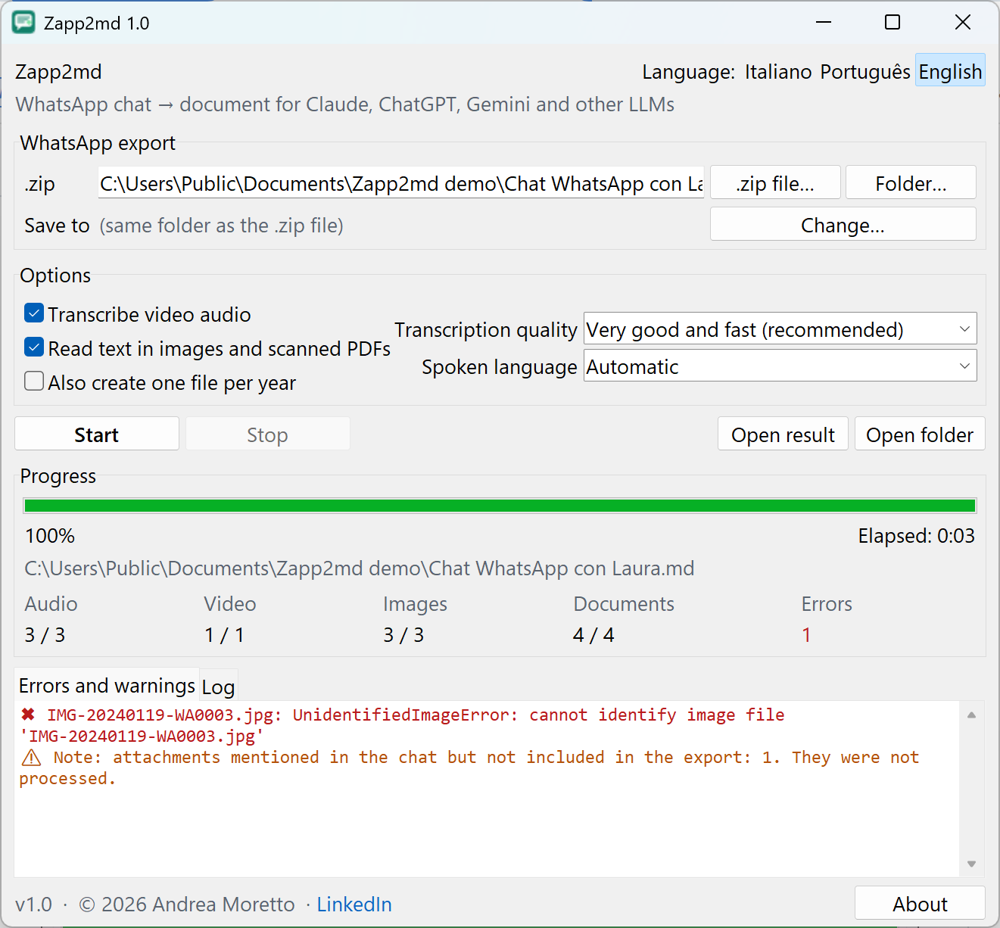

<p align="center">
  
</p>

<h1 align="center">Zapp2md</h1>

<p align="center">
  <b>WhatsApp chat exports → one Markdown document for Claude, ChatGPT, Gemini and other LLMs</b><br>
  Voice messages transcribed · text read from images and PDFs · 100% local · free<br>
  <a href="#english">English</a> · <a href="#italiano">Italiano</a> · <a href="#português">Português</a>
</p>

<p align="center">
  <a href="../../releases/latest"><b>⬇ Download Zapp2md-1.0-Setup.exe</b></a> (Windows 10/11, 64-bit, ~2 MB)
</p>

<p align="center">
  
</p>

---

## English

Zapp2md turns the export of a WhatsApp chat — even years of messages and hundreds of MB of media — into a
**single chronological Markdown file** that you can give to an LLM such as Claude, ChatGPT or Gemini, or to any
other AI tool, for in-depth analysis and research.

**What it extracts**

| Content | What you get in the document |
|---|---|
| Voice messages and audio | Full transcript (Whisper large-v3-turbo), automatic language detection, timestamps for long messages |
| Videos | Transcript of the audio track (optional) |
| Images | Visible text (Windows built-in OCR), size, EXIF date / camera / GPS when present |
| Documents | Text of PDF (scanned pages too), Word, Excel, PowerPoint, TXT/CSV, contact cards |
| Chat | Every message, by day, with sender and time; summary with participants and statistics |

**Highlights**
- **Private:** everything runs on your PC. No account, no API key, no data sent anywhere.
- **Free, no recurring costs.**
- **Robust:** handles Android and iPhone exports, many date formats, corrupted or missing files.
  You can stop at any time and resume later without losing work.
- **Interface and document in Italiano, Português or English.**
- Clear window with progress, time remaining, files processed by type and errors.

### Install

1. Download **`Zapp2md-1.0-Setup.exe`** from [Releases](../../releases/latest). No administrator rights needed.
2. Windows may show *"Windows protected your PC"* because the installer is not digitally signed:
   click **More info → Run anyway**. You can verify the file first (see [Verification](#verification)).
3. At the end of the installation a console window prepares the components. **Only what is missing on your PC
   is downloaded** (at most ~2 GB: Python, libraries, transcription model). Tick *Full installation* to download
   everything again instead.
4. Start menu: **Zapp2md**, **Repair Zapp2md** (downloads only what is missing or damaged) and
   **Repair Zapp2md (full reinstall)**.

### Use

1. On the phone: open the chat → contact name / menu → **Export chat** → **Attach media**. Copy the `.zip` to the PC.
   (With *Without media* the voice messages are not in the file: Zapp2md tells you.)
2. Open Zapp2md, choose the `.zip` (or drag it onto the Zapp2md icon) and press **Start**.
3. When finished, **Open result**: upload the `.md` file to your LLM.

Speed on a typical PC without a dedicated graphics card: a short voice message takes ~6-8 s, one hour of audio
~30-40 min. Very large chats can be split into one file per year.

### Verification

| | |
|---|---|
| SHA256 | `4907e88320889cbf80d81feb9993ecc3ec053cfbf98a3e92c19096c8d82a3136` |
| VirusTotal | [Scan report](https://www.virustotal.com/gui/file/4907e88320889cbf80d81feb9993ecc3ec053cfbf98a3e92c19096c8d82a3136): clean for Microsoft Defender, Kaspersky, Malwarebytes, McAfee, Symantec, Sophos and most engines. 2 of 65 engines report generic heuristic flags (Arctic Wolf *Unsafe*, Skyhigh *ObfuscatedPoly*), a known false positive for unsigned installers built with Inno Setup, whose compressed content looks obfuscated. The complete source code and build script are in this repository. |

Check it yourself in PowerShell: `Get-FileHash .\Zapp2md-1.0-Setup.exe -Algorithm SHA256`

---

## Italiano

Zapp2md trasforma l'esportazione di una chat WhatsApp — anche anni di messaggi e centinaia di MB di media — in un
**unico file Markdown cronologico** da dare a un LLM come Claude, ChatGPT o Gemini, o ad altri strumenti di AI,
per analisi e ricerche approfondite.

- **Vocali e audio:** trascrizione completa, lingua riconosciuta automaticamente.
- **Video:** trascrizione della traccia audio (facoltativa).
- **Immagini:** testo visibile (OCR di Windows), dimensioni, dati EXIF.
- **Documenti:** PDF (anche scansionati), Word, Excel, PowerPoint, TXT/CSV, contatti.
- **Privato e gratuito:** tutto resta sul tuo PC, nessun account, nessun costo ricorrente.
- **Robusto:** formati Android e iPhone, file danneggiati o mancanti; si può interrompere e riprendere.

**Installazione:** scarica `Zapp2md-1.0-Setup.exe` dalle [Releases](../../releases/latest). Se Windows mostra
*"Windows ha protetto il PC"* (l'installatore non è firmato digitalmente) clicca **Ulteriori informazioni → Esegui
comunque**. Viene scaricato **solo ciò che manca** sul PC (al massimo ~2 GB); l'opzione *Installazione completa*
riscarica tutto. Nel menu Start trovi anche **Ripara Zapp2md** e **Ripara Zapp2md (reinstallazione completa)**.

**Uso:** sul telefono *Esporta chat → Allega media*, porta lo `.zip` sul PC, apri Zapp2md, scegli il file e premi
**Avvia**. Al termine **Apri il risultato** e carica il file `.md` nel tuo LLM.

## Português

O Zapp2md transforma a exportação de uma conversa do WhatsApp — mesmo anos de mensagens e centenas de MB de
multimédia — num **único ficheiro Markdown cronológico** para dar a um LLM como o Claude, o ChatGPT ou o Gemini,
ou a outras ferramentas de IA, para análises e pesquisas aprofundadas.

- **Mensagens de voz e áudio:** transcrição completa, idioma reconhecido automaticamente.
- **Vídeos:** transcrição da faixa de áudio (opcional).
- **Imagens:** texto visível (OCR do Windows), dimensões, dados EXIF.
- **Documentos:** PDF (também digitalizados), Word, Excel, PowerPoint, TXT/CSV, contactos.
- **Privado e gratuito:** tudo fica no seu PC, sem conta e sem custos recorrentes.

**Instalação:** descarregue `Zapp2md-1.0-Setup.exe` das [Releases](../../releases/latest). Se o Windows mostrar
*"O Windows protegeu o PC"* (o instalador não está assinado digitalmente) clique em **Mais informações → Executar
mesmo assim**. Só é descarregado **o que falta** no PC (no máximo ~2 GB).

**Utilização:** no telemóvel *Exportar conversa → Anexar multimédia*, copie o `.zip` para o PC, abra o Zapp2md,
escolha o ficheiro e prima **Iniciar**. No fim, **Abrir o resultado** e carregue o ficheiro `.md` no seu LLM.

---

## Build from source

Requirements: Windows 10/11 and [Inno Setup 6](https://jrsoftware.org/isinfo.php) (`winget install JRSoftware.InnoSetup`).

```bat
installer\build.bat
```

The script compiles the small launcher `Zapp2md.exe` (C#, with the compiler built into Windows), builds
`dist\Zapp2md-1.0-Setup.exe` and writes `dist\SHA256SUMS.txt`.

| Folder | Content |
|---|---|
| `app/` | the program: `zapp2md.py` (engine, also usable from the command line), `gui.py` (window), `i18n.py` (texts), `setup.ps1` (component download / repair) |
| `launcher/` | source of `Zapp2md.exe` |
| `installer/` | Inno Setup script and build script |

Command line: `python app\zapp2md.py chat.zip --ui en --video --split-by-year` (`--help` for all options).

## Licence

**Zapp2md © 2026 [Andrea Moretto](https://www.linkedin.com/in/andrea-moretto-mba/)** —
[Creative Commons BY-NC-SA 4.0](https://creativecommons.org/licenses/by-nc-sa/4.0/):
free to use, copy and share (also modified), always crediting the author; **selling it or any commercial use is
not allowed**; modified versions must keep the same licence. See [LICENSE](LICENSE).
Third-party components downloaded during installation keep their own licences: see
[THIRD-PARTY-NOTICES.txt](app/THIRD-PARTY-NOTICES.txt).

WhatsApp is a trademark of WhatsApp LLC. Zapp2md is an independent project and is not affiliated with,
endorsed or sponsored by WhatsApp LLC or Meta.
